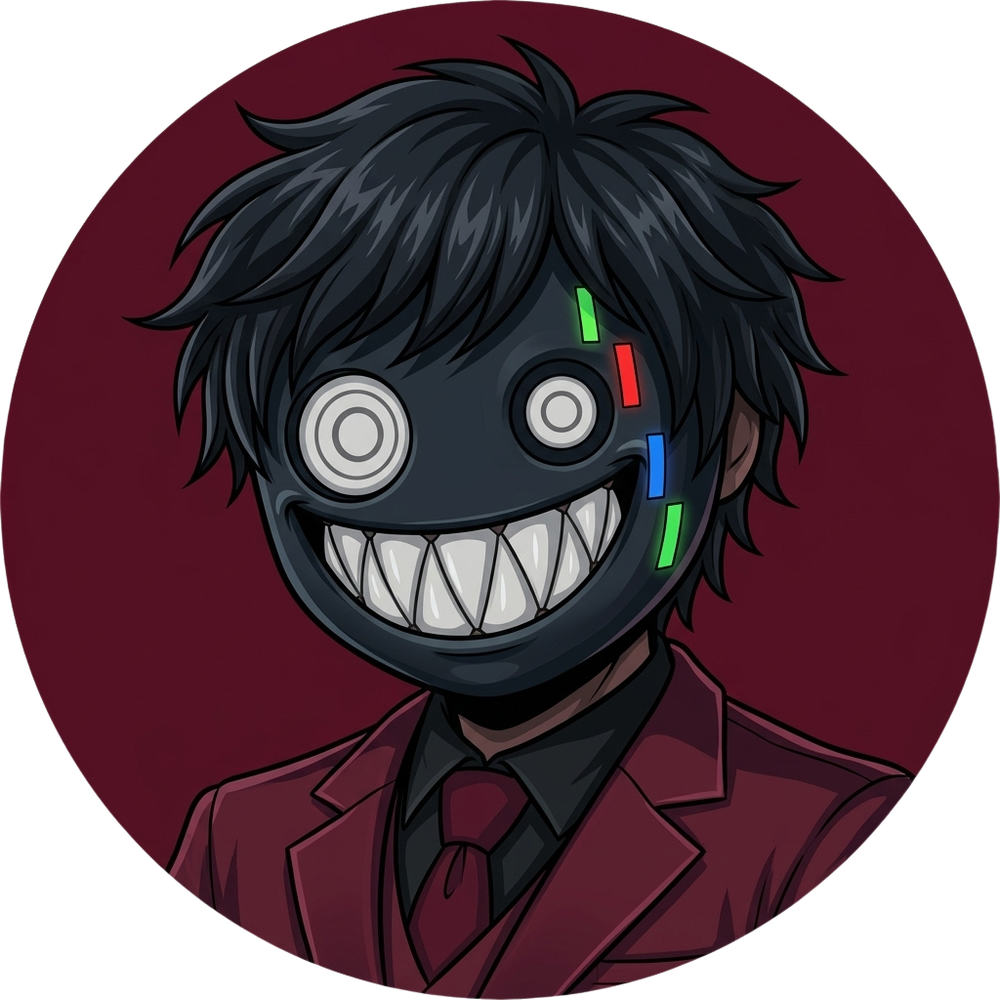
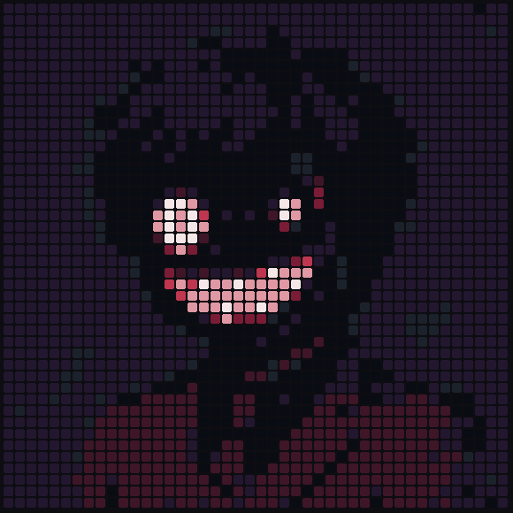

  
   
  

  <h1>James Douglas Streck da Palma</h1>
  
<strong>Desenvolvedor Full Stack · Back-end</strong>

  
Transformando demandas e problemas em soluções através da tecnologia.

  
  
  

---

<h2 align="center">Sobre mim</h2>

Sou estudante de **Sistemas de Informação na Uninter**, técnico em **Informática pelo Senac de Santa Maria** e desenvolvedor Full Stack. Atualmente, atuo como **estagiário na Asten AVMB**, trabalhando com desenvolvimento e evolução de software.

Minha atuação envolve compreender demandas, investigar comportamentos de sistemas, implementar funcionalidades, adaptar soluções existentes e resolver problemas técnicos. Tenho uma base consistente em desenvolvimento back-end, com atuação profissional utilizando **Java e Spring**, além de experiência prática com **PHP** e desenvolvimento com **Node.js**. Também trabalho com tecnologias de front-end, APIs e integração entre aplicações.

Gosto de entender o problema antes de partir para a implementação e de buscar soluções que façam sentido para o contexto do sistema e para quem vai utilizá-lo.

<h2 align="center">Experiência e formação</h2>

  <strong>Estagiário Full Stack — Asten by AVMB</strong>
   
  Desenvolvimento e evolução de sistemas, implementação e adaptação de funcionalidades, análise de demandas e resolução de problemas. Atuação profissional com Java Spring, Vue, Typescript entre outras ferramentas e frameworks.

 

  <strong>Formação</strong>
   
  Sistemas de Informação — Uninter (em andamento)
   
  Técnico em Informática — Senac Santa Maria

<h2 align="center">Tecnologias e ferramentas</h2>

<h3 align="center">Back-end e APIs</h3>

  

  Atuação profissional com Java e Spring · Experiência prática com PHP, Node.js e Express

  
   
  Python — conhecimento básico

<h3 align="center">Front-end</h3>

  

<h3 align="center">Banco de dados e ferramentas</h3>

  

<h2 align="center">Projetos e experiências em destaque</h2>

### Sistema de reserva de veículos — Senac RS

Participei do desenvolvimento de um sistema para apoiar o processo de reserva e organização de veículos do Senac local. O projeto partiu de uma necessidade institucional de otimizar e melhorar o código antigo que por si só precisou de uma restauração completa.

### Portfólio — Nutrição

Desenvolvi um site de apresentação para uma profissional da área de nutrição, com foco em identidade visual, organização dos serviços e presença digital. O projeto envolveu estruturação de conteúdo e construção de uma interface voltada à experiência de navegação.

https://app.netlify.com/projects/eduarda-ferraz-nutricao-endurance/overview

### ASTEN AVMB - Sigad

Integro a equipe de Desenvolvimento e Soluções do SIGAD, contribuindo para a evolução do sistema por meio da análise de demandas, implementação de funcionalidades, criação e adaptação de componentes e resolução de problemas. Essa experiência tem fortalecido minha capacidade de propor soluções, lidar com diferentes desafios técnicos e atuar em um ambiente corporativo de grande porte, com experiência em uma empresa de atuação internacional.

### Repositórios públicos

| Projeto                                                                                       | Descrição                                                                                                                                     |
| --------------------------------------------------------------------------------------------- | --------------------------------------------------------------------------------------------------------------------------------------------- |
| [clinicaReact](https://github.com/JamesStackDev/clinicaReact)                                 | Projeto de clínica feito durante o treinamento das competições regionais, com operações de CRUD e API REST, organizado em cliente e servidor. |
| [make-your-burger-3](https://github.com/JamesStackDev/make-your-burger-3)                     | Projeto que fiz durante aprendizado de front-end desenvolvido com Vue.js.                                                                     |
| [projeto-avmb-de-aprendizagem](https://github.com/JamesStackDev/projeto-avmb-de-aprendizagem) | Repositório de aprendizagem com estrutura de back-end e TypeScript.                                                                           |

Os projetos públicos representam parte da minha prática. Também participei de projetos institucionais e independentes que não estão publicados neste perfil.

<h2 align="center">Estatísticas do GitHub</h2>

  
  

<h2 align="center">Contribuições</h2>

  

  

---

  
<strong>"Aprendizado, nunca é de mais."</strong>

  
Aberto a conexões profissionais, oportunidades e projetos colaborativos.

  <a href="mailto:contato.jamesdouglasstreck@gmail.com">Entre em contato</a>
    
  James Douglas Streck da Palma · 2026

